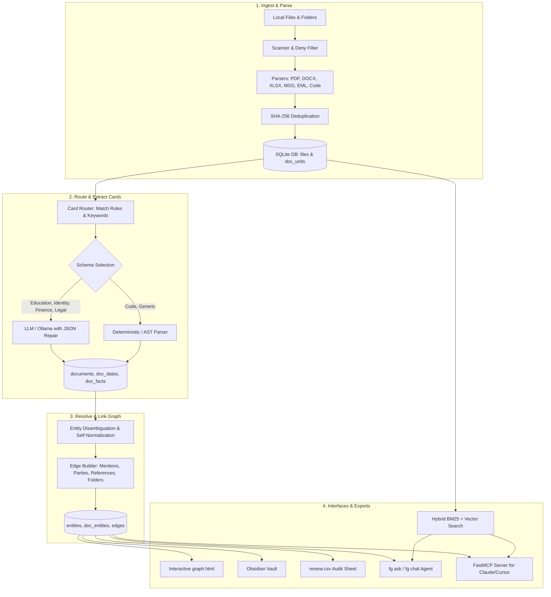

# FileGraph

[](https://www.python.org/downloads/)
[](https://www.sqlite.org/fts5.html)
[](#privacy-guarantee--security)
[-orange.svg)](#mcp-server-model-context-protocol)
[](LICENSE)

**FileGraph** is a local-first knowledge graph, hybrid search engine, and agentic assistant for your personal file system. It indexes local folders containing documents, identity cards, educational certificates, invoices, emails, spreadsheets, and source code repositories. 

FileGraph extracts typed, validated **cards** using local (Ollama) or cloud LLMs, builds a rich entity-relationship graph, provides conversational question answering over read-only SQL and graph traversal, exposes a Model Context Protocol (MCP) server for Claude Desktop and Cursor, and generates an interactive, standalone HTML knowledge visualizer.

---

## Table of Contents

- [Key Highlights](#key-highlights)
- [Architecture & Data Pipeline](#architecture--data-pipeline)
- [Interactive Visual Knowledge Graph](#interactive-visual-knowledge-graph)
- [Commands Overview](#commands-overview)
- [Quickstart & Installation](#quickstart--installation)
- [Configuration (`filegraph.yaml`)](#configuration-filegraphyaml)
- [Asking Questions (`fg ask` & `fg chat`)](#asking-questions-fg-ask--fg-chat)
- [Model Context Protocol (MCP) Server](#mcp-server-model-context-protocol)
- [Automated Filing & Backtesting](#automated-filing--backtesting)
- [Discovering & Proposing New Card Types](#discovering--proposing-new-card-types)
- [Live Monitoring & Watchdog](#live-monitoring--watchdog)
- [Privacy Guarantee & Security](#privacy-guarantee--security)
- [Repository Structure](#repository-structure)
- [Running the Test Suite](#running-the-test-suite)

---

## Key Highlights

- **100% Local-First & Zero Egress:** Configure sensitive folders with `llm: local` (via Ollama) or `llm: metadata_only`. Document text never leaves your workstation.
- **Automatic Entity & Relationship Graph:** Resolves document holders, family members, schools, universities, boards, employers, and banks into unified entity nodes with typed edges (`party`, `references`, `amends`, `replies_to`, `in_folder`).
- **Resilient Extraction Pipeline:** Built-in JSON healing algorithms balance truncated LLM outputs, handle small local models without native tool-calling support, and apply deterministic regex fallbacks.
- **Standalone Offline Graph Visualizer (`graph.html`):** Inlines a vendored `vis-network` bundle into a single standalone HTML file with dark/light themes, folder hubs, hierarchical tree view, domain color badges, and detail inspection drawer.
- **Hybrid Search (BM25 + Dense Vectors):** Combines SQLite FTS5 full-text keyword ranking with vector embeddings using Reciprocal Rank Fusion (RRF).
- **Agentic SQL & Graph QA:** Natural language assistant (`fg ask` / `fg chat`) with read-only SQL, symbol lookup, directory exploration, and graph traversal tools.
- **Native Model Context Protocol (MCP):** Connect your desktop files directly to **Claude Desktop**, **Cursor**, or any MCP-compliant agent using FastMCP over stdio.
- **Obsidian Vault & CSV Audit Exports:** Generates an Obsidian-compatible markdown vault with bidirectional wikilinks (`[[Doc]]`) and an audit spreadsheet (`review.csv`) with review flags and extracted facts.

---

## Architecture & Data Pipeline



---

## Interactive Visual Knowledge Graph

Running `python fg.py graph` compiles your entire indexed knowledge base into a self-contained, standalone `graph.html`.

### Features of the Visual Graph:
- **Zero External Dependencies:** `vis-network.min.js` is fully inlined—no internet connection or external CDNs required.
- **Semantic Domain Palette:**
  - 🟣 **Awards & Training (`#a855f7`):** Slide decks, certificates of completion, certifications.
  - 🔵 **Educational Documents (`#6366f1`):** High school memos, 12th standard TCs, B.Tech bonafides, consolidated transcripts.
  - 🌸 **Entities & Institutions (`#ec4899`):** Universities (CBIT, Osmania), Colleges (Narayana Junior College), Schools (Blooming Buds), Government Boards (TSBIE, Income Tax Dept).
  - 🟢 **Finance & Tax (`#10b981`):** Bank passbooks, invoices, salary slips, tax receipts.
  - 📁 **Folder Hub Clusters (`#3b82f6`):** Groups related documents by directory clusters for organized exploration.
  - 🟠 **Identity Profiles (`#f59e0b`):** Aadhaar cards, passports, driver's licenses, voter IDs.
  - 🩵 **Projects & Engineering (`#06b6d4`):** Project summaries, markdown briefs, architecture overviews.
  - 🔘 **Tech Stack & Libraries (`#64748b`):** Docker, AWS ECS, FastAPI, Langfuse, OpenCV.
- **Interactive Controls:**
  - `📁 Folders`: Toggle folder clustering hubs.
  - `🌳 Tree`: Switch between force-directed physics layout and Left-to-Right hierarchical dependency tree.
  - `🏷️ Labels`: Toggle visibility of document and entity labels.
  - `🎯 Focus`: Dim unconnected nodes when selecting an item.
  - `👻 Orphans`: Show or hide disconnected nodes.
  - `👥 Mentions`: Expand causal entity mentions into the graph.
  - `🌐 Top Hubs`: Focus view on the 25 busiest central nodes.
  - `⛶ Fit`: Auto-center and fit graph to viewport.
  - `☀️ / 🌙`: Toggle sleek Dark / clean Light modes.
  - `/` Keyboard Shortcut: Instant quick-search drawer.
  - **Slide-in Detail Drawer:** Click any node to inspect document summaries, entity party roles, dates, confidence scores, extracted key facts, connected relationships, and a direct link to open the original local file.

---

## Commands Overview

The CLI provides 23 modular subcommands covering the entire knowledge indexing lifecycle:

| Subcommand | Description | LLM Required? |
|---|---|:---:|
| `fg init` | Initializes project configuration (`filegraph.yaml`, `.env`) and creates SQLite database with FTS5. | No |
| `fg roots` | Displays configured roots, LLM privacy tiers, indexed file counts, and ingest status. | No |
| `fg ingest [--root R] [--workers N]` | Scans directories, parses document text, extracts embedded email/PDF attachments, and detects Git repositories. | No |
| `fg inventory` | Summarizes indexed documents by extension, card category, and provides token estimation. | No |
| `fg extract [--limit N] [--root R] [--card C] [--refresh]` | Extracts structured typed cards from raw files using LLM or deterministic schema rules. | **Yes** |
| `fg repos [list\|summarize] [--repo R] [--refresh]` | Analyzes Git repositories, maps symbols and imports, and generates architectural summaries. | **Yes** |
| `fg embed [--root R] [--rebuild]` | Computes dense vector embeddings for hybrid semantic search using local or provider embedders. | Local |
| `fg link` | Merges entity spelling variants, resolves institutional parties, and constructs relationship edges. | No |
| `fg search "query" [--kind K] [--root R] [--card C]` | Runs hybrid BM25 full-text + vector search with Reciprocal Rank Fusion directly in terminal. | No |
| `fg ask "question" [-v] [--allow-cloud]` | Runs conversational question-answering agent using read-only SQL, symbol search, and graph traversal. | **Yes** |
| `fg chat [-v] [--allow-cloud]` | Starts an interactive, persistent terminal chat session with the FileGraph agent. | **Yes** |
| `fg discover [--min N] [--all]` | Analyzes generic documents to detect clusters and suggest candidate card schemas. | No |
| `fg propose-card TYPE [--samples N]` | Generates a new YAML card schema draft from extracted cluster samples. | **Yes** |
| `fg cards` | Lists all registered card schemas, priorities, LLM requirements, and absorbed document counts. | No |
| `fg file PATH [--root R] [--apply] [--move] [--yes]` | Analyzes an unfiled document and recommends (or applies) the ideal destination directory. | **Yes** |
| `fg backtest [-n N] [--root R] [--model M]` | Evaluates filing accuracy on existing documents and exports `backtest_results.csv`. | **Yes** |
| `fg vault [dir]` | Exports an Obsidian-compatible markdown vault with bidirectional links between docs and entities. | No |
| `fg graph [out.html]` | Builds a standalone interactive `vis-network` HTML visualization (`graph.html`). | No |
| `fg review-csv [out.csv]` | Exports a spreadsheet catalog with dates, facts, confidence scores, and audit flags. | No |
| `fg report` | Prints catalog health, flagged review items, error logs, and token consumption metrics. | No |
| `fg mcp` | Launches the Model Context Protocol (FastMCP) server over stdio for Claude Desktop / Cursor. | No |
| `fg watch [--interval 300]` | Runs a live watchdog process to detect file modifications and execute incremental pipeline runs. | **Yes** |
| `fg run [--root R] [--limit N] [--yes]` | End-to-end execution: ingest → extract → repos → link → embed → vault → graph → review-csv. | **Yes** |

---

## Quickstart & Installation

### 1. Requirements
- Python 3.10+ (ensure Python's SQLite build includes FTS5 support)
- [Ollama](https://ollama.com/) (recommended for 100% offline local LLM extraction)

### 2. Setup Virtual Environment

```bash
# Clone the repository
git clone https://github.com/bottesaketh-dev/filegraph.git
cd filegraph

# Create and activate virtual environment
python -m venv venv

# Windows (PowerShell):
.\venv\Scripts\Activate.ps1
# Linux / macOS:
source venv/bin/activate

# Install core dependencies
pip install -r requirements.txt

# Install optional dependencies (MCP server, sentence-transformers, watchdog)
pip install -r requirements-optional.txt
```

### 3. Initialize Project & Configuration

```bash
python fg.py init
```
This checks SQLite FTS5 capability, copies template configuration files, and initializes `filegraph.db`.

### 4. Configure Your Roots & LLM

Edit `filegraph.yaml` to point to your document folders:
```yaml
me:
  names: ["Your Name", "Your Full Name"]
  organizations: ["Your Org LLC"]

roots:
  - path: "C:/Users/YourName/Documents"
    name: docs
    profile: auto
    llm: local      # local (Ollama) | cloud (OpenAI/Anthropic) | metadata_only
```

If using local Ollama, ensure your model is running:
```bash
ollama run qwen2.5:3b
```

### 5. Run the End-to-End Pipeline

```bash
# Execute the entire workflow in one command:
python fg.py run --yes
```

Or run step-by-step:
```bash
python fg.py ingest                 # Scan files and extract text
python fg.py inventory              # Review catalog counts and token estimates
python fg.py extract --yes          # Extract structured cards with LLM
python fg.py link                   # Build knowledge graph edges and resolve entities
python fg.py graph                  # Generate standalone interactive graph.html
```

### 6. View Your Graph

Double-click `graph.html` to open it in your browser, or serve it via Python:
```bash
python -m http.server 8085
# Open: http://localhost:8085/graph.html
```

---

## Configuration (`filegraph.yaml`)

```yaml
# Identity configuration for self-entity disambiguation
me:
  names: ["Saketh Botte", "Botte Saketh", "B. Saketh"]
  organizations: ["Harborline Events LLC"]

# Root folders to index
roots:
  - path: "C:/Users/SakethBotte/Documents_and_Certificates"
    name: docs
    profile: auto          # auto | <card name>
    llm: local             # local | cloud | metadata_only

# Global ignore patterns (gitignore syntax)
ignore:
  - "node_modules/"
  - ".venv/"
  - "venv/"
  - "__pycache__/"
  - "dist/"
  - "build/"
  - ".git/"
  - "*.lock"
  - "*.min.js"

# Deny list: files that are NEVER opened or indexed
deny:
  - "**/.ssh/**"
  - "**/*.kdbx"
  - "**/.env"
  - "**/secrets.json"

# File size & execution limits
limits:
  max_file_mb: 50
  max_text_chars_per_file: 2000000
  confirm_tokens_over: 2000000

# Extraction tuning
extraction:
  head_pages: 8
  tail_pages: 4
  max_image_pages: 8
  max_text_chars: 60000
  image_dpi: 110
  workers: 4

# Code indexing policies
code:
  per_file_llm: false      # code files use fast deterministic AST parsing
  repo_summaries: true     # generate architectural repo summaries with LLM

# Hybrid search tuning
search:
  rrf_k: 60
  bm25_candidates: 50
  vector_candidates: 50
```

---

## Asking Questions (`fg ask` & `fg chat`)

FileGraph equips an agent with read-only tools to interrogate the knowledge index:
- `run_sql`: Execute read-only SQL queries over SQLite schema (`files`, `documents`, `entities`, `doc_dates`, `doc_facts`, `edges`).
- `search`: Run hybrid BM25 + dense vector semantic retrieval.
- `get_related`: Traverse graph connections for any document or entity.
- `read_document`: Retrieve structured card metadata, facts, and dates.
- `read_file`: Inspect raw content or specific line offsets.
- `find_symbol`: Look up functions, classes, and methods across indexed repositories.

### Example Queries

```bash
# Identity and Expiry queries
python fg.py ask "When does my passport expire and what is the document number?" -v

# Institutional queries
python fg.py ask "Which college did I attend for intermediate and what were my marks?" -v

# Cross-document analysis
python fg.py ask "List all active insurance policies across the family and their premium amounts."

# Code repository exploration
python fg.py ask "Where do we define the JWT authentication middleware across repos?"

# Interactive terminal chat
python fg.py chat
```

---

## Model Context Protocol (MCP) Server

FileGraph features a native **FastMCP** server that exposes your entire document catalog, hybrid search, and graph traversal tools to external AI clients.

### Adding FileGraph to Claude Desktop

Add this block to your `claude_desktop_config.json`:
- **Windows:** `%APPDATA%\Claude\claude_desktop_config.json`
- **macOS:** `~/Library/Application Support/Claude/claude_desktop_config.json`

```json
{
  "mcpServers": {
    "filegraph": {
      "command": "C:\\Users\\YourName\\Projects\\filegraph\\venv\\Scripts\\python.exe",
      "args": [
        "C:\\Users\\YourName\\Projects\\filegraph\\fg.py",
        "mcp"
      ]
    }
  }
}
```

### Available MCP Tools:
- `search`: Hybrid keyword and semantic retrieval.
- `run_sql`: Safe read-only SQL queries over the index.
- `get_related`: Graph neighbor and relationship discovery.
- `read_document`: Card details, key facts, and entity participants.
- `read_file`: Raw file text viewing.
- `find_symbol`: AST code symbol resolution.
- `grep`: Fast ripgrep / regex pattern matching.
- `list_dir`: Indexed directory browsing.
- `describe_cards`: Active card schemas and preferred keys.
- **Resource `filegraph://schema`:** Real-time database catalog and schema reference.

---

## Automated Filing & Backtesting

FileGraph assists with organizing new, unfiled documents by analyzing folder naming conventions, entity co-occurrences, and sibling files:

```bash
# Suggest destination folder for a downloaded invoice
python fg.py file "C:/Downloads/LOQ_Invoice.pdf"

# Automatically move/copy the file to the recommended path without collisions
python fg.py file "C:/Downloads/LOQ_Invoice.pdf" --apply --yes

# Backtest filing precision against your existing directory structure
python fg.py backtest -n 25
```

---

## Discovering & Proposing New Card Types

FileGraph ships with five core card schemas (`generic`, `identity`, `finance`, `legal`, `code`). When your file system contains clusters of unclassified documents, FileGraph can discover and generate custom schemas:

```bash
# 1. Discover clusters of similar unclassified documents
python fg.py discover --min 5

# 2. Propose a new card YAML schema from clustered samples
python fg.py propose-card medical_record

# 3. Review the proposed YAML in cards/proposed/ and move to cards/
mv cards/proposed/medical_record.yaml cards/

# 4. Re-extract matching documents with the new card
python fg.py extract --card medical_record --refresh
```

---

## Live Monitoring & Watchdog

Keep your index up to date continuously:

```bash
# Monitor roots for additions, edits, and deletions with debounced batching
python fg.py watch --interval 300
```

On production systems, FileGraph can be scheduled via Windows Task Scheduler or `cron`:
```bash
0 */4 * * * /path/to/venv/bin/python /path/to/filegraph/fg.py run --yes
```

---

## Privacy Guarantee & Security

- **Strict Deny Rules:** Files matching patterns in `deny` (e.g. `.ssh/**`, `*.kdbx`, `.env`, `id_rsa*`) are intercepted at the scanner level and are **never opened, read, or indexed**.
- **Automatic Secret Redaction:** Regex filters automatically detect and replace API keys, tokens, and credentials with `[REDACTED]` before storing document text or sending context to LLMs.
- **Zero Cloud Leakage for Local Roots:** Any root configured with `llm: local` uses local models exclusively. No file paths, text snippets, or embeddings are transmitted outside your machine.
- **Safe Read-Only Operations:** The agent and MCP tools operate strictly with `PRAGMA query_only = ON`. Modifying or dropping database tables via agent queries is impossible.

---

## Repository Structure

```text
filegraph/
├── cards/                     # YAML card schemas (identity, finance, legal, code, generic)
│   ├── code.yaml
│   ├── finance.yaml
│   ├── generic.yaml
│   ├── identity.yaml
│   └── legal.yaml
├── filegraph/                 # Core engine package
│   ├── agent.py               # Conversational QA agent and tool execution
│   ├── config.py              # YAML settings and root configurations
│   ├── db.py                  # SQLite schema creation and connection management
│   ├── discover.py            # Card discovery and schema proposal
│   ├── embed.py               # Vector embedding generation (local/provider)
│   ├── export.py              # Vault, CSV review, and graph.html compilation
│   ├── extract.py             # Card routing and structured LLM extraction
│   ├── filing.py              # Document destination filing and backtesting
│   ├── graph_template.py      # Standalone vis-network interactive UI template
│   ├── ingest.py              # Multi-format parsing, attachments, and deduplication
│   ├── link.py                # Entity resolution and knowledge graph edge builder
│   ├── llm.py                 # LLM client abstractions, fallbacks, and JSON repair
│   ├── mcp_server.py          # FastMCP server implementation
│   ├── repos.py               # Git repo ingestion and AST symbol graph
│   ├── search.py              # Hybrid BM25 FTS5 + vector reciprocal rank fusion
│   ├── security.py            # Secret redaction and deny-list evaluation
│   ├── walk.py                # Filesystem scanner and path filter
│   └── watch.py               # Watchdog live directory monitor
├── tests/                     # Comprehensive pytest test suite
│   ├── test_agent_tools.py
│   ├── test_cli_smoke.py
│   ├── test_db.py
│   ├── test_export.py
│   ├── test_extract.py
│   ├── test_ingest.py
│   ├── test_link.py
│   ├── test_mcp.py
│   └── test_search.py
├── fg.py                      # Main CLI entry point
├── filegraph.yaml.example     # Template configuration
├── requirements.txt           # Core Python dependencies
├── requirements-optional.txt  # Optional dependencies (MCP, watchdog, embeddings)
└── vis-network.min.js         # Offline visualization bundle for graph.html
```

---

## Running the Test Suite

The test suite runs with simulated offline responses without requiring live LLM API keys:

```bash
# Run the complete test suite
pytest

# Run CLI smoke tests
pytest tests/test_cli_smoke.py -v
```

---

## License

This project is licensed under the [MIT License](LICENSE).
